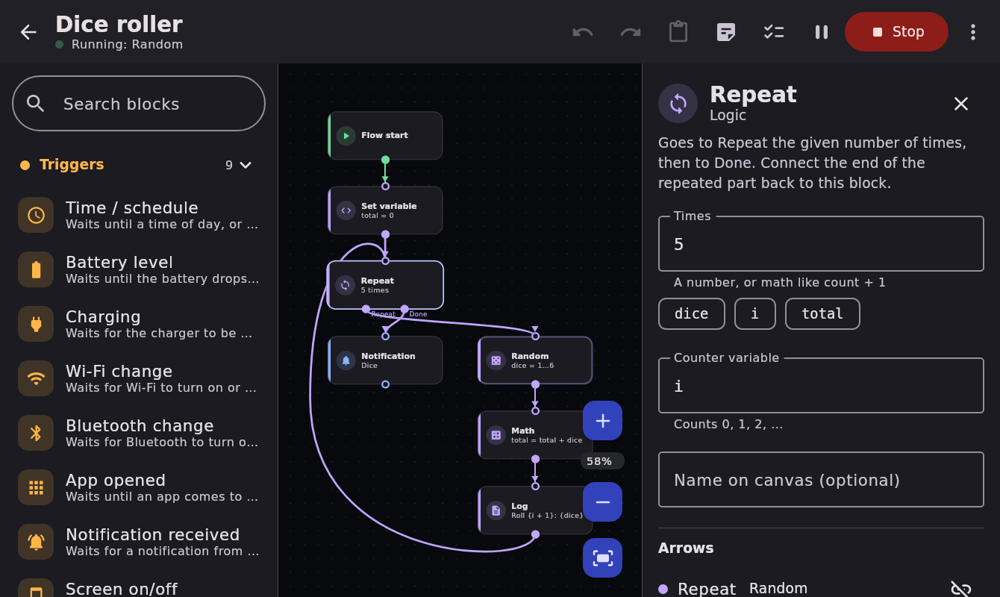

# AutoFlow

A no-code automation app for Android in the spirit of Automate: you build flows by dragging
blocks onto an infinite canvas and connecting them with arrows. Kotlin + Jetpack Compose,
Material 3 with dynamic colors, Room, WorkManager and AlarmManager. No root.

Made for a Galaxy Tab A11 (Android 14, 4 GB RAM), works on Android 8.0+ phones and tablets.



## Getting the APK

The debug APK has **not** been built yet: the machine this was written on can't reach Google's
Maven server (`dl.google.com`), which hosts the Android build plugin and the androidx libraries.
Any of these produces `AutoFlow-debug.apk`:

1. **GitHub, no PC needed.** Put this folder in a GitHub repository (the `.github/workflows/build.yml`
   workflow is included). Every push builds the APK on GitHub's servers. On `main` it is published to a
   release named `latest`: open the repo's Releases page on the tablet and tap `AutoFlow-debug.apk`.
   Every build also keeps it as a downloadable artifact on the Actions tab.
2. **A computer with Android Studio**: open the folder and press Run, or run `./build.sh`
   (needs JDK 17 and the Android SDK with platform 35). The APK lands in `dist/`.
3. **A cloud session whose network allows `dl.google.com`**: run `./build.sh` there.

Installing: allow "Install unknown apps" for your browser or Files app when Android asks.

## What's in it

**Editor**: pinch to zoom, drag to pan, double-tap to zoom in, "fit" button. Drag blocks from the
palette sidebar (tablet) or the + button (narrow screens), or tap one to add it under the selected
block, wired up already. Drag from an output dot onto a block to connect. Long-press to multi-select;
copy, cut, paste, duplicate, delete, undo/redo, sticky-note comments. Block search. A side
inspector edits the selected block. Problems (missing start, bad expressions, unreachable blocks) show
in a banner. Flows save automatically.

**Home**: flow cards with live status, run/stop/pause, logs, rename, duplicate, delete, export,
"start when the tablet turns on", ten templates, import/export of `.autoflow.json` files
(opening such a file from a file manager also imports it).

**Blocks (34)**

| Triggers | Actions | Logic |
|---|---|---|
| Time / schedule (days of week) | Notification | Flow start |
| Battery level | Toast | Stop flow |
| Charging | Open app or URL | If / else |
| Wi-Fi change | Flashlight | Wait |
| Bluetooth change / device | Volume | Repeat (N times) |
| App opened | Brightness | Set variable |
| Notification received | Wi-Fi / Bluetooth / other settings panel | Math |
| Screen on/off/unlocked | Vibrate | Text tools |
| Headphones plugged | Text to speech | Random |
| | Clipboard | User dialog / input |
| | Write file / Read file | Log |
| | HTTP request | |
| | Share | |

Text fields accept `{expressions}`: `Battery is {battery}%`, `{x * 2 + 1}`, `{upper(name)}`,
`{hour() >= 22 ? "late" : "early"}`. About 30 functions (math, text, time, random).

**Runtime**: several flows at once, each with its own log (per-block timing, filters, problems only).
Pause, resume, stop, "Stop all". A flow may have several "Flow start" blocks running in parallel.
The file and HTTP blocks have a "Failed" arrow for handling errors; any other block that hits an error
stops its flow and logs why.

**Battery**: the foreground service (with its required notification) only runs while a flow is
active. When every active flow is just waiting for a time at least 5 minutes away, AutoFlow saves
its state, sets one exact alarm, and stops the service completely until then. Event triggers
register their Android listeners only while a flow is waiting on them. "App opened" polls usage
stats every 2 s with the screen on and every 15 s with it off. Logs are written in batches and
trimmed daily by WorkManager.

**Permissions** are asked only when a flow needs them: before a flow starts, AutoFlow lists what
its blocks need (notifications, nearby devices, display over other apps, modify system settings,
notification access, usage access, alarms & reminders, files folder). The inspector shows the same
per block. Without a permission, the block stops its flow with a clear log message (or takes its "Failed"
arrow) instead of crashing the app.

Android 10+ only lets apps open other apps, links, dialogs and the share sheet from the background with
"Display over other apps". The user dialog block also posts a heads-up notification to answer from.
Wi-Fi and Bluetooth can't be switched by apps on Android 10+, so those blocks open the quick
settings panel instead.

## Layout

```
core/      Pure Kotlin, no Android: flow model, expression language, block catalog, engine,
           validator, templates. Unit-tested on any JVM.
app/       Android app
  runtime/   Foreground service, alarms, receivers, event sources, block executors, permissions
  data/      Room database, repository, settings
  ui/        Compose screens: editor/ (canvas, palette, inspector), home/, logs/, settings/
  ui/android Activity, view model, theme, dialog screen
tools/verify  Off-device checks used while building this (see TESTING.md)
```

## Adding a block

1. Describe it in `core/.../blocks/Catalog.kt` (type, category, title, icon, params, outputs,
   permissions, one-line summary) and add it to `all`. The palette, search, inspector, validator
   and permission prompts pick it up from there.
2. Give it behavior: an entry in `AndroidExecutors.all` (Android) or `LogicExecutors.all` (pure Kotlin).
   An executor is `suspend (RunContext) -> String?` returning the output port to follow:
   ```kotlin
   "action.toast" to ex { c ->
       val text = c.text("text")              // param with {expressions} filled in
       c.android.onMain { Toast.makeText(c.android.context, text, Toast.LENGTH_SHORT).show() }
       "next"
   },
   ```
   Triggers are blocks that suspend until their event happens (see `trigger.battery`).
3. Optionally map its icon key in `ui/common/BlockIcons.kt`.
